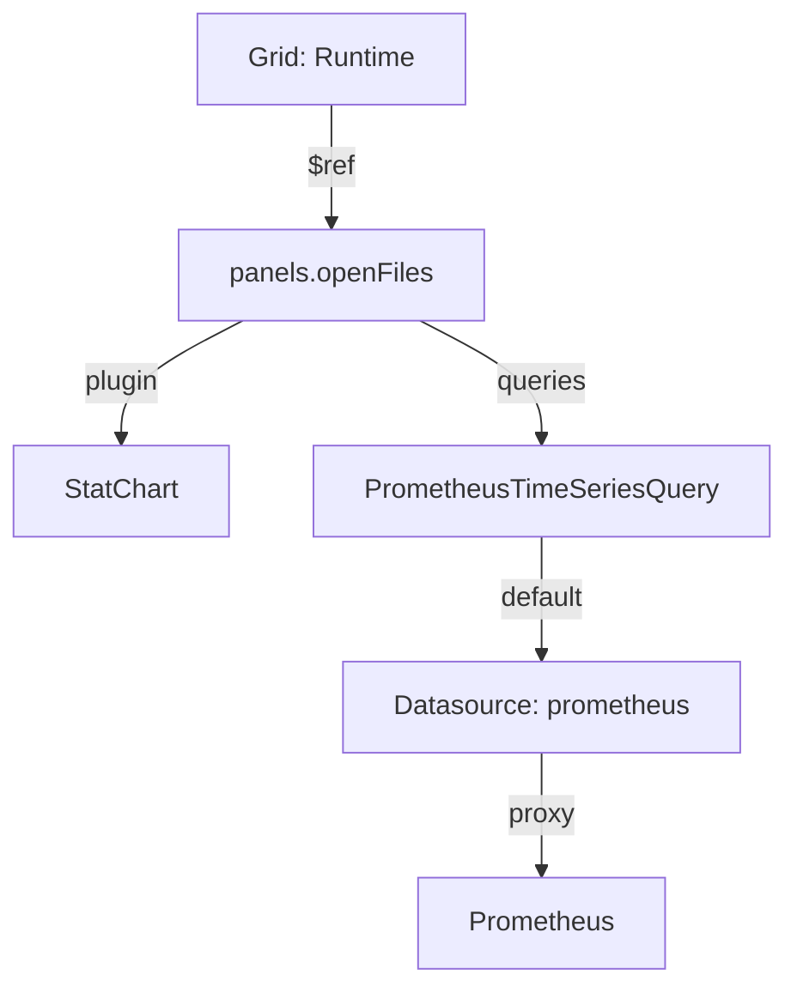

# Panels, Queries And Layouts

A dashboard is only as useful as its panels, and in Perses a panel is defined in one place and drawn in another. That split is the part of the specification people get wrong most often, because Grafana keeps both in one object. This part writes a small dashboard by hand, applies it, and follows one panel from its layout item to its query.

## A dashboard written by hand

The dashboard below shows two facts about the Prometheus process: how many goroutines it runs, and how many files it has open. A goroutine is a lightweight thread inside a Go program such as Prometheus. Read the YAML from the top: two panels under `panels`, then one layout under `layouts` that places them.

<!-- astrona:playground:renew -->

Save this as `dashboard-runtime.yaml`:

```yaml
kind: Dashboard
metadata:
  name: runtime
  project: specs
spec:
  display:
    name: Prometheus Runtime
  duration: 1h
  panels:
    goroutines:
      kind: Panel
      spec:
        display:
          name: Goroutines
        plugin:
          kind: TimeSeriesChart
          spec:
            legend:
              position: bottom
        queries:
          - kind: TimeSeriesQuery
            spec:
              plugin:
                kind: PrometheusTimeSeriesQuery
                spec:
                  query: go_goroutines
                  seriesNameFormat: "{{job}}"
    openFiles:
      kind: Panel
      spec:
        display:
          name: Open files
        plugin:
          kind: StatChart
          spec:
            calculation: last-number
            format:
              unit: decimal
        queries:
          - kind: TimeSeriesQuery
            spec:
              plugin:
                kind: PrometheusTimeSeriesQuery
                spec:
                  query: process_open_fds
  layouts:
    - kind: Grid
      spec:
        display:
          title: Runtime
          collapse:
            open: true
        items:
          - x: 0
            y: 0
            width: 16
            height: 8
            content:
              $ref: "#/spec/panels/goroutines"
          - x: 16
            y: 0
            width: 8
            height: 8
            content:
              $ref: "#/spec/panels/openFiles"
```

Apply it:

```sh
percli apply -f dashboard-runtime.yaml
```

Then check the result:

```sh
percli get dashboards
percli describe dashboard runtime -ojson | jq '.spec.panels | to_entries | map({key, kind: .value.spec.plugin.kind})'
```

`percli apply` sends the file to the Perses server, which checks it and stores it; `percli` answers that the object `Dashboard` `runtime` has been applied. The list now shows two dashboards, and the second command shows the two panel keys with their plugin kinds: `goroutines` is a `TimeSeriesChart`, `openFiles` is a `StatChart`. Open `http://perses.localtest.me:8080` in your browser, go to the project `specs`, and open `Prometheus Runtime` to see both panels draw.

## What a panel holds

The `panels` field is a map, not a list. Each key, such as `goroutines`, is a name you choose; it must be unique inside the dashboard, and the layouts use it to find the panel. Each value is an object with `kind: Panel` and a `spec` with three fields:

| Field | What it holds |
| --- | --- |
| `display` | The panel title (`name`) and an optional `description` |
| `plugin` | The panel plugin: `kind` names the type of chart, `spec` holds that plugin's settings |
| `queries` | A list of queries whose results the panel draws |

A **plugin** is the code that provides one panel type, query type, variable type or datasource type. Perses itself does not know what a stat chart is; the `StatChart` plugin does, and it decides which settings its `spec` accepts. That is why the two panels above have different `spec` fields: `TimeSeriesChart` takes a `legend`, and `StatChart` takes a `calculation`, the rule that turns a series of values into the one number it shows.

## What a query holds

A query also has two levels. The outer `kind` says what sort of data the panel expects, here `TimeSeriesQuery`, a series of values over time. The inner `plugin` says how to get it: `PrometheusTimeSeriesQuery` sends a PromQL expression to a Prometheus datasource. The inner `spec` holds the expression in `query` and an optional `seriesNameFormat`, the legend text, in which `{{job}}` is replaced by the value of the label `job`.

Neither query names a datasource. When a query leaves out `datasource`, Perses uses the default datasource of the right kind, and the project `specs` has one: the `PrometheusDatasource` called `prometheus`. Writing it out is optional, and looks like this inside the query plugin `spec`:

```yaml
datasource:
  kind: PrometheusDatasource
  name: prometheus
```

## How a layout places a panel

The `layouts` list says where panels appear. A `Grid` layout is one group of panels with a title, which a reader can open and close (`collapse.open`). Each item of `items` gives a position and a size in grid units, and a `content` with a `$ref`. A `$ref` is a JSON reference: a path inside the same document, written from the root (`#`) down to the panel.



The diagram follows one item: the grid points at the panel `openFiles`, the panel names its chart plugin and its query, and the query goes through the default datasource `prometheus` to the Prometheus server.

Grafana does the same job in one object: each Grafana panel has a `gridPos` with `x`, `y`, `w` and `h`, and its queries in `targets`. Grafana's grid is 24 units wide, and so is Perses' grid, so the numbers carry over: `gridPos.w` becomes `width` and `gridPos.h` becomes `height`. A panel that no layout item points at is stored but never drawn, and an item that points at a missing key draws nothing.

You can now write panels with a plugin and a query, place them with a `Grid` layout, and apply the result. Still open is how a dashboard offers choices, such as which handler to show, and how the server decides what a plugin's `spec` may contain.

## Common pitfalls

> [!WARNING]
> - **A `$ref` that does not match a panel key.** The key is case-sensitive: `#/spec/panels/openfiles` does not find `openFiles`.
> - **Writing panels as a list.** `panels` is a map from key to panel. A YAML list (`- kind: Panel`) is not valid there.
> - **Mixing up the two kinds of a query.** The outer `kind` is `TimeSeriesQuery`; the plugin `kind` is `PrometheusTimeSeriesQuery`.
> - **Forgetting the quotes around a `$ref`.** In YAML, an unquoted `#` starts a comment, so `$ref: #/spec/panels/x` is empty.

