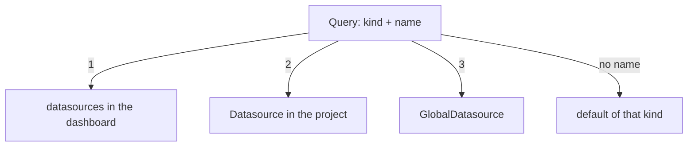

# Variables, Datasources And Plugin Schemas

A dashboard that shows one fixed thing is rarely enough: people want to pick a handler, a job or an instance from a list and see the panels change. They also need to trust that a dashboard file is valid before it reaches production. This part adds a variable to a dashboard, shows how a query finds the datasource that answers it, and makes the Perses server refuse a value that breaks a plugin's rules.

## A dashboard with a variable

A **variable** is a value the reader picks above the dashboard, which queries use as `$name`. The dashboard below offers the HTTP status codes that Prometheus has answered, and its panel shows the request rate for the chosen code.

<!-- astrona:playground:renew -->

Save this as `dashboard-status-codes.yaml`:

```yaml
kind: Dashboard
metadata:
  name: status-codes
  project: specs
spec:
  display:
    name: Status Codes
  duration: 6h
  refreshInterval: 30s
  variables:
    - kind: ListVariable
      spec:
        name: code
        display:
          name: Status code
        allowAllValue: true
        allowMultiple: false
        customAllValue: ".*"
        plugin:
          kind: PrometheusLabelValuesVariable
          spec:
            labelName: code
            matchers:
              - prometheus_http_requests_total
  panels:
    rate:
      kind: Panel
      spec:
        display:
          name: Request rate for the chosen code
        plugin:
          kind: TimeSeriesChart
          spec: {}
        queries:
          - kind: TimeSeriesQuery
            spec:
              plugin:
                kind: PrometheusTimeSeriesQuery
                spec:
                  query: sum by (code) (rate(prometheus_http_requests_total{code=~"$code"}[5m]))
                  seriesNameFormat: "{{code}}"
  layouts:
    - kind: Grid
      spec:
        display:
          title: Requests
        items:
          - x: 0
            y: 0
            width: 24
            height: 8
            content:
              $ref: "#/spec/panels/rate"
```

Apply it:

```sh
percli apply -f dashboard-status-codes.yaml
```

Then check the result:

```sh
percli describe dashboard status-codes -ojson | jq '.spec.variables[0].spec | {name, plugin: .plugin.kind, labelName: .plugin.spec.labelName}'
```

The answer shows a variable named `code`, filled by the plugin `PrometheusLabelValuesVariable` from the label `code`. Open `Status Codes` in your browser: a list called `Status code` appears above the panel, and choosing a code changes the panel. The dashboard also opens on the last six hours and reloads every 30 seconds, because of `duration: 6h` and `refreshInterval: 30s`.

## List variables and text variables

Perses has two kinds of variable. A `ListVariable` offers a list of values, and its `plugin` decides where the list comes from. A `TextVariable` holds one value the reader types, or a fixed value when `constant` is `true`. The list settings are part of the specification, not of the plugin:

| Field | What it does |
| --- | --- |
| `name` | The name queries use, as `$code` or `${code}` |
| `display.name` | The label shown above the dashboard |
| `allowAllValue` | Adds the choice All |
| `customAllValue` | The value used when All is chosen, for example `.*` for a regular expression match |
| `allowMultiple` | Lets the reader choose more than one value |
| `defaultValue` | The value chosen when the dashboard opens |
| `sort` | How the values are ordered, for example `alphabetical-asc` |

The Prometheus plugin brings four variable plugins. `PrometheusLabelValuesVariable` lists the values of one label, optionally for some series selectors in `matchers`. `PrometheusLabelNamesVariable` lists label names. `PrometheusPromQLVariable` runs an expression and lists the values of one label in the result. `StaticListVariable`, a separate plugin, holds a fixed list of values.

## How a query finds its datasource

A **datasource** is the Perses resource that describes how to reach a data backend. The project `specs` has one called `prometheus`. Look at its definition:

```sh
percli get datasources
percli describe datasource prometheus -ojson | jq '.spec'
```

The `spec` shows `default: true` and a plugin of kind `PrometheusDatasource` with a `proxy` of kind `HTTPProxy` and the URL `http://prometheus.observability:9090`. The proxy means the browser never talks to Prometheus directly: the Perses server forwards each query to that URL, so it only has to work from inside the cluster.

A query selects a datasource with a `datasource` field that holds a `kind` and, optionally, a `name`. Perses looks for that datasource in three scopes, smallest first:



The diagram shows the order: a datasource defined in the dashboard's own `spec.datasources` wins over a project `Datasource` with the same name, which wins over a `GlobalDatasource`, a datasource shared by every project. When the query names no datasource, Perses uses the datasource marked `default` for that kind. A name that exists in no scope leaves the panel without data, which is the most common fault after a migration from Grafana.

## Plugins check their own part

Each plugin ships a **plugin schema**: a definition, written in CUE, of what its `spec` may contain. CUE is a language for describing and checking data. The `StatChart` schema, for example, says that `calculation` must be one of `first`, `last`, `first-number`, `last-number`, `mean`, `sum`, `min` or `max`, and its `spec` is closed, so an unknown field is an error too. The Perses server checks every panel, query, variable and datasource of a dashboard against the schema of its plugin.

See it refuse a value. This file is the same as the runtime stat panel, with `average` as its calculation, a word Grafana users often expect.

Save this as `dashboard-bad-calculation.yaml`:

```yaml
kind: Dashboard
metadata:
  name: bad-calculation
  project: specs
spec:
  duration: 1h
  panels:
    openFiles:
      kind: Panel
      spec:
        display:
          name: Open files
        plugin:
          kind: StatChart
          spec:
            calculation: average
        queries:
          - kind: TimeSeriesQuery
            spec:
              plugin:
                kind: PrometheusTimeSeriesQuery
                spec:
                  query: process_open_fds
  layouts:
    - kind: Grid
      spec:
        items:
          - x: 0
            y: 0
            width: 8
            height: 6
            content:
              $ref: "#/spec/panels/openFiles"
```

Check it against the server's plugins without storing it, then try to apply it:

```sh
percli lint -f dashboard-bad-calculation.yaml --online
percli apply -f dashboard-bad-calculation.yaml
```

`percli lint --online` sends the file to the server's validation endpoint, `/api/validate/dashboards`, and reports an error for the panel `openFiles`: the value `average` does not match the `calculation` the `StatChart` schema allows. `percli apply` fails for the same reason, and the server stores nothing. Change `average` to `mean`, and both commands succeed.

## Grafana and Perses side by side

You have now met every part of a Perses dashboard. The table maps each part of a Grafana dashboard JSON file to the Perses field that does the same job:

| Grafana dashboard JSON | Perses dashboard |
| --- | --- |
| `uid` | `metadata.name` |
| `title` | `spec.display.name` |
| folder | project (`metadata.project`) |
| `time.from` (for example `now-6h`) | `spec.duration` (`6h`) |
| `refresh` | `spec.refreshInterval` |
| `templating.list[]` | `spec.variables[]` |
| `panels[]` with `type` | `spec.panels` map with `plugin.kind` |
| `panels[].gridPos` | items in `spec.layouts[].spec.items` |
| row panel | one `Grid` layout with a `display.title` |
| `targets[].expr` | `queries[].spec.plugin.spec.query` |
| `targets[].legendFormat` | `seriesNameFormat` |
| `targets[].datasource.uid` | `datasource.name` |
| `fieldConfig.defaults.unit` | the plugin's `format.unit` |

You can now read and write a whole Perses dashboard, choose how its queries find their datasource, and let the server check it before anyone opens it. What is still open is doing this for many dashboards at once, which is the job of the migration tool.

## Common pitfalls

> [!WARNING]
> - **A query that names a datasource that does not exist.** The dashboard saves without an error, and the panel stays empty. Leave the name out to use the default, or name a datasource that exists.
> - **Using Grafana's words in a plugin spec.** `average`, `lastNotNull` and `reqps` are Grafana values. The Perses plugins use `mean`, `last-number` and `requests/sec`.
> - **Linting without `--online`.** Without it, `percli` checks the file with what it knows locally. With it, the server checks the file against the plugins it really runs.
> - **Forgetting `customAllValue`.** With `allowAllValue` and a query using `=~"$code"`, the All choice needs a regular expression such as `.*`.

## Your mission: Write A Perses Dashboard By Hand

You can now read a Grafana dashboard and write the Perses panels, queries, layout, variable and time settings that match it. The graded lab gives you the Grafana dashboard `HTTP Requests` and asks you to write its Perses equivalent by hand in the project `specs`, with queries that return the same data.

The lab runs in its own cluster, so first pause your playground. Nothing in it is lost:

```sh
astrona stop ats-109-playground-010-01
```

Then start the lab:

```sh
astrona run --git ssh://git@github.com/astrona-io/ATS109.git -c sections/section-010/module-01/labs/lab-01
```

The task is on the next page. Solve it on your own first. When you think you are done, send it for grading:

```sh
astrona submit -c sections/section-010/module-01/labs/lab-01
```

When the lab is done, remove it and start your playground again:

```sh
astrona destroy ats-109-lab-010-01
astrona start ats-109-playground-010-01
```
