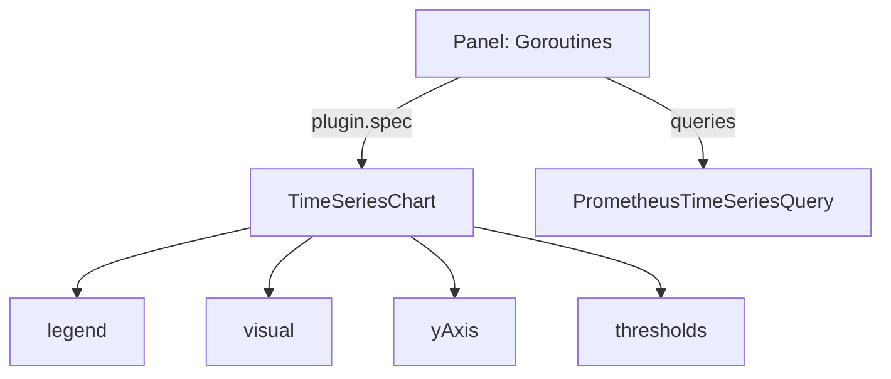

# Time Series Chart Settings

The time series chart is the panel people use most, and the one a migration produces most often. Its `spec` decides how lines look, where the legend sits and how the vertical axis is drawn. This part writes one panel with the settings that matter, applies it, and shows what each setting changes.

## One panel, four groups of settings

A panel plugin is the code that draws one kind of panel, and its `spec` holds only the settings that plugin understands. The `TimeSeriesChart` plugin groups its settings in four fields: `legend`, `visual`, `yAxis` and `thresholds`. The panel below shows the number of goroutines of Prometheus. A goroutine is a lightweight thread inside a Go program.

<!-- astrona:playground:renew -->

Save this as `dashboard-ts-settings.yaml`:

```yaml
kind: Dashboard
metadata:
  name: ts-settings
  project: specs
spec:
  display:
    name: Time Series Settings
  duration: 1h
  panels:
    goroutines:
      kind: Panel
      spec:
        display:
          name: Goroutines
        plugin:
          kind: TimeSeriesChart
          spec:
            legend:
              position: right
              mode: table
              values:
                - mean
                - last
            visual:
              display: line
              lineWidth: 2
              areaOpacity: 0.2
            yAxis:
              show: true
              label: goroutines
              min: 0
              format:
                unit: decimal
        queries:
          - kind: TimeSeriesQuery
            spec:
              plugin:
                kind: PrometheusTimeSeriesQuery
                spec:
                  query: go_goroutines
                  seriesNameFormat: "{{job}}"
  layouts:
    - kind: Grid
      spec:
        display:
          title: Runtime
        items:
          - x: 0
            y: 0
            width: 24
            height: 8
            content:
              $ref: "#/spec/panels/goroutines"
```

Apply it:

```sh
percli apply -f dashboard-ts-settings.yaml
```

Then check the result:

```sh
percli describe dashboard ts-settings -ojson | jq '.spec.panels.goroutines.spec.plugin.spec | keys'
```

The answer lists `legend`, `visual` and `yAxis`. Open `Time Series Settings` in the project `specs` in your browser to see the chart.

## The legend

The `legend` field controls the list of series names next to the chart. `position` is `bottom` or `right`. `mode` is `list` or `table`: a table can show one extra column for every entry in `values`, and each entry is a calculation such as `mean`, `last`, `min` or `max` that reduces the series to one number. The text of each name comes from the query's `seriesNameFormat`, not from the legend. Remove the `legend` field and the chart shows no legend.

## The visual settings

The `visual` field controls how a series is drawn. `display` is `line` or `bar`. `lineWidth` is the thickness of the line, and `areaOpacity` fills the area under the line with a number from 0 (no fill) to 1. `stack` set to `all` stacks the series on top of each other, and `connectNulls` joins a line over missing points instead of leaving a gap. Change `lineWidth` to `4`, apply the file again and reload the page: only the line thickness changes, because the data and the query did not change.

## The vertical axis

The `yAxis` field holds `show`, a `label`, a `min` and a `max`, and a `format`. The format is the same object that a stat chart uses: `unit` names how a number is printed, such as `decimal`, `bytes`, `seconds` or `requests/sec`, and `decimalPlaces` sets the digits after the point. Setting `min: 0` makes the axis start at zero, which stops a flat line from looking like a large change.

## Thresholds on a chart

A **threshold** is a value at which a colour changes. On a time series, `thresholds` draws a line at each step. It has a list of `steps`, each with a `value` and a `color`, and an optional `mode` of `absolute` or `percent`. Add this field to the `spec` of the panel, next to `yAxis`:

```yaml
thresholds:
  steps:
    - value: 100
      color: "#ff9830"
    - value: 200
      color: "#f2495c"
```

Apply the file again. The chart now shows two lines, orange at 100 and red at 200. The query did not change, so the numbers are the same; only what the panel shows around them did. A setting that the plugin does not know, such as `lineWeight`, is refused by the server, because the plugin schema is closed.



The diagram shows that the four groups of settings belong to the chart plugin, and the query belongs to the panel.

You can now set the legend, the line style, the axis and the thresholds of a time series chart. Still open are the panels that show one number instead of a line.

## Common pitfalls

> [!WARNING]
> - **Putting chart settings on the panel.** `legend` and `yAxis` go inside `plugin.spec`, not next to `plugin`.
> - **Writing `mode: table` and expecting columns without `values`.** The table then has only the series names.
> - **Setting a unit on the wrong field.** On a time series the unit is `yAxis.format.unit`.
> - **Using threshold values in the wrong scale.** The values are compared with the raw numbers, so a percent as a fraction needs `0.9`, not `90`.
