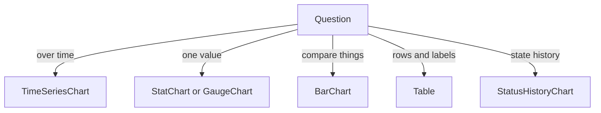

# Units, Thresholds And Choosing A Plugin

Every panel plugin that shows a number needs the same three decisions: how to print it, which colour it has, and which plugin fits the data. A wrong decision here does not cause an error. The panel draws, and it says the wrong thing. This part collects the rules for units and thresholds and ends with a way to choose a plugin.

## Units

A **unit** is the name of a print format. It is the `unit` field of a `format` object, and the object sits in different places: `yAxis.format` for a time series, and `format` for a stat, gauge, bar and pie chart. The most used units are in the table.

| Unit | Prints | Use for |
| --- | --- | --- |
| `decimal` | a plain number | counts and ratios without a unit |
| `percent` | `42` as `42%` | values already between 0 and 100 |
| `percent-decimal` | `0.42` as `42%` | fractions between 0 and 1 |
| `bytes` | `1048576` as `1 MiB` | memory and disk sizes |
| `seconds`, `milliseconds` | a time with a fitting suffix | durations |
| `requests/sec` | a rate | `rate(...)` of a request counter |

The choice depends on the scale of the query, not on the name of the metric. A query that returns `0.42` and has the unit `percent` prints `0.42%`, which is wrong by a factor of 100.

Print the scale before you choose. This command runs an instant query through the datasource proxy of the project `specs`, so the answer is Prometheus' own:

<!-- astrona:playground:renew -->

```sh
kubectl -n observability exec deploy/tester -- curl -s -X POST \
  http://perses.localtest.me:8080/proxy/projects/specs/datasources/prometheus/api/v1/query \
  --data-urlencode 'query=process_open_fds / process_max_fds' | jq '.data.result[0].value'
```

The answer is a pair of a time and a value as text. The value is a small fraction, far below `1`, so the right unit is `percent-decimal`, not `percent`.

## Thresholds

A **threshold** step has a `value` and a `color`. A panel uses the colour of the highest step whose value the number has reached. The first step normally has the value `0` (or a very low number) and the colour that means "fine". The step list is ordered from low to high:

```yaml
thresholds:
  steps:
    - value: 0
      color: "#73bf69"
    - value: 0.7
      color: "#ff9830"
    - value: 0.9
      color: "#f2495c"
```

The colours here are green, orange and red. With the unit `percent-decimal`, a value of `0.75` is orange and `0.95` is red. The same steps with the values `70` and `90` would colour nothing, because the number never gets that high.

A Grafana threshold has a base step with the value `null`. The Perses steps start at a number, which is why the migration writes `0` for the base step. That is correct for a value that can never be negative, and wrong for a temperature or a difference, so check it by hand for values that can go below zero.

## Choosing a plugin

Start from the question the panel answers, then pick the plugin.

- How does a value change over time? Use `TimeSeriesChart`.
- What is the current value of one thing? Use `StatChart`, or `GaugeChart` when there is a known maximum.
- How do several things compare right now? Use `BarChart`, and `PieChart` only for parts of one total.
- Which rows exist, with their labels? Use `Table`.
- What should the reader know about the dashboard? Use `Markdown`.
- Did a state change over time, such as up or down? Use `StatusHistoryChart`.

The server cannot check this choice. It checks that the `spec` fits the plugin, not that the plugin fits the question.



The diagram maps each kind of question to the panel plugin that answers it.

You can now pick the plugin, the unit and the thresholds for a panel and justify each choice with the scale of the data. The lab that follows asks you to build a dashboard where each of these choices matters.

## Common pitfalls

> [!WARNING]
> - **Choosing a unit by the metric name.** Choose it by the scale of the query result.
> - **Copying Grafana threshold values without checking the unit.** A `percentunit` threshold of `0.9` stays `0.9` with `percent-decimal`, but not with `percent`.
> - **Forgetting the first step.** A step list that starts at `0.7` leaves lower values without a colour.
> - **Using a gauge without a known maximum.** Use a stat chart instead.

## Your mission: Build A Runtime Dashboard With Four Panel Plugins

You can now choose a panel plugin for a question and set its calculation, unit and thresholds. The graded lab asks you to write a dashboard `runtime-panels` in the project `specs` with a stat, a time series, a gauge with thresholds and a bar chart, each with the right unit.

The lab runs in its own cluster, so first pause your playground. Nothing in it is lost:

```sh
astrona stop ats-109-playground-010-02
```

Then start the lab:

```sh
astrona run --git ssh://git@github.com/astrona-io/ATS109.git -c sections/section-010/module-02/labs/lab-01
```

The task is on the next page. Solve it on your own first. When you think you are done, send it for grading:

```sh
astrona submit -c sections/section-010/module-02/labs/lab-01
```

When the lab is done, remove it and start your playground again:

```sh
astrona destroy ats-109-lab-010-02
astrona start ats-109-playground-010-02
```
