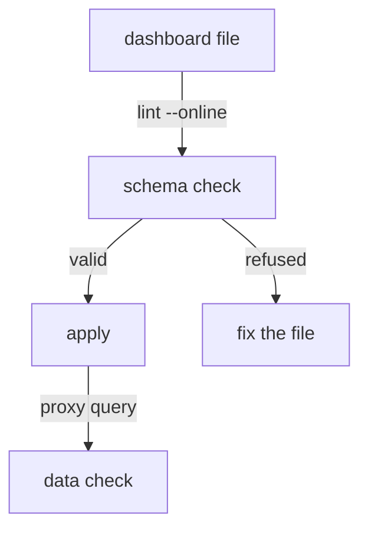

# Validating A Dashboard Without Applying It

Applying a dashboard changes the server. Validating it does not. This part checks a dashboard file in two ways before you store it, breaks the file on purpose to see the error, and then shows what validation cannot find.

## Two ways to validate

The first way is the command `percli lint`. With the flag `--online` it sends the file to the Perses server, which checks it with the plugin schemas that are loaded there. Without the flag it checks only against schemas on your machine, which would not know the plugins of the server. Always use `--online` in this course.

<!-- astrona:playground:renew -->

```sh
percli lint -f dashboard-variables-chained.yaml --online
```

The command prints a message that says the file is valid and exits with the code `0`. The file is a dashboard with a job list, a handler list that depends on it, a window list and one request rate panel. If you do not have it, apply any valid dashboard of the project `specs` and save it with `percli describe dashboard <name> -ojson`.

The second way is the validation endpoint. It takes the dashboard as JSON and answers with a status code, and it is the call a script or a grader can make without `percli`:

```sh
percli describe dashboard variables-chained -ojson > variables-chained.json
kubectl -n observability exec -i deploy/tester -- curl -s -o /dev/null -w '%{http_code}\n' -X POST \
  -H 'Content-Type: application/json' --data-binary @- \
  http://perses.localtest.me:8080/api/validate/dashboards < variables-chained.json
```

The answer is `200`. The first command saves the stored dashboard to a file, and the second sends the file to the endpoint from the `tester` pod. A body that breaks a schema gives a `400` with a message.

## Break a file to read the error

Change one line of the file `dashboard-variables-chained.yaml`. In the panel, replace the plugin `spec` with a setting the schema does not know:

```yaml
          kind: TimeSeriesChart
          spec:
            lineWeight: 3
```

Run the lint command again:

```sh
percli lint -f dashboard-variables-chained.yaml --online
```

The command exits with a non-zero code and prints the message from the server. The message names the panel and the plugin that refused the value, because each plugin checks only its own part. Remove the line again, and the file passes.

A value of the wrong type fails the same way. A `calculation` of `average` on a `StatChart` is refused because the schema lists the allowed words, and `mean` is the Perses word for it. Read the message to the end: the allowed values are often part of it.

## What validation cannot find

Validation checks the structure and the plugin schemas. It does not run the queries, and it does not look for datasources or variables by name. A dashboard whose query names the datasource `missing`, or uses `$jobb` instead of `$job`, passes with `200` and shows an empty panel. Only a query through the datasource proxy, with the variables replaced by real values, shows that a panel has data.

Make it a routine in three steps. Lint the file, apply it, and run each query through the proxy. The first step catches shape errors, and the third catches data errors.



The diagram shows that the schema check runs before the apply, and the data check runs after it.

You can now validate a dashboard without storing it and read the error. The lab that follows asks you to build a dashboard where the variables, the matcher and the query all have to work together.

## Common pitfalls

> [!WARNING]
> - **Linting without `--online`.** The result says nothing about the plugins of the server.
> - **Reading `200` as proof of data.** A valid dashboard can show only empty panels.
> - **Fixing the stored dashboard and not the file.** The next apply from the file brings the error back.
> - **Stopping at the first error.** The server reports one error at a time, so lint again after each fix.

## Your mission: Build A Dashboard With Chained Variables

You can now define variables, chain them with a matcher and validate the result. The graded lab asks you to write a dashboard `variable-panels` in the project `specs` with a job list, a handler list that depends on the job, a fixed window list and one panel that uses all three.

The lab runs in its own cluster, so first pause your playground. Nothing in it is lost:

```sh
astrona stop ats-109-playground-010-03
```

Then start the lab:

```sh
astrona run --git ssh://git@github.com/astrona-io/ATS109.git -c sections/section-010/module-03/labs/lab-01
```

The task is on the next page. Solve it on your own first. When you think you are done, send it for grading:

```sh
astrona submit -c sections/section-010/module-03/labs/lab-01
```

When the lab is done, remove it and start your playground again:

```sh
astrona destroy ats-109-lab-010-03
astrona start ats-109-playground-010-03
```
