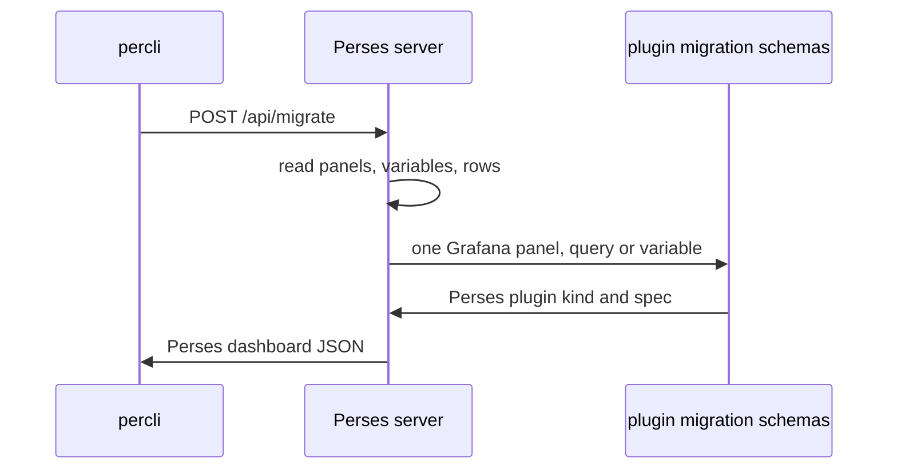

# How Migration Works

Before you trust a migrated dashboard, you need to know who translated it and by which rules. This part runs `percli migrate` on a Grafana dashboard, then follows the dashboard's identity, time range, panels and rows through the translation. Every fact here comes from what the migration really does in Perses v0.54.0.

## Run a migration

First fetch the Grafana dashboard. The Grafana HTTP API returns it wrapped in an object with a `dashboard` field, and the migration needs only the inner dashboard.

<!-- astrona:playground:renew -->

```sh
kubectl -n observability exec deploy/tester -- \
  curl -s http://grafana.observability:3000/api/dashboards/uid/prometheus-overview | jq '.dashboard' > prometheus-overview.json
jq '{uid, title, time, refresh, panels: (.panels | length), variables: [.templating.list[].name]}' prometheus-overview.json
```

The file holds the uid `prometheus-overview`, the title `Prometheus Overview`, a time range of three hours, a refresh of one minute, eight entries in `panels`, and four variables: `job`, `handler`, `interval` and `filter`.

With the Perses port-forward running in your second terminal, sign `percli` in and migrate the file:

```sh
percli login http://perses.localtest.me:8080
percli migrate -f prometheus-overview.json --online -o json > overview-migrated.json
jq '{kind, name: .metadata.name, display: .spec.display.name, tags: .metadata.tags, duration: .spec.duration}' overview-migrated.json
```

`percli migrate` prints the Perses dashboard, here saved to a file. Its `kind` is `Dashboard`, its `metadata.name` is `prometheus-overview`, its display name is `Prometheus Overview`, and the tag `legacy` is kept. Its `duration` is `1h`, not three hours.

## Who does the work

The `--online` flag matters. With it, `percli` sends the Grafana JSON to the Perses server's endpoint `POST /api/migrate`, and the server sends back the translated dashboard. The server does not store it; storing is a separate step. Without `--online`, `percli` needs `--plugin.path`, a local folder of Perses plugins, and translates on your machine. The two flags cannot be used together.



The diagram shows the split of work: the server translates the frame of the dashboard (name, panels map, layouts, variable settings), and for each panel, query and variable it runs the **migration schema** of the plugin that claims it. A migration schema is a `migrate.cue` file that a plugin ships next to its own schema. The `StatChart` plugin, for example, declares that it migrates the Grafana type `stat`, and its file turns Grafana's `options` and `fieldConfig` into a `StatChart` `spec`.

That is why `--online` is the recommended mode: the server runs exactly the plugins it serves, so the migrated dashboard matches what the server will accept.

## What happens to identity and time

The dashboard's identity carries over, but its time settings do not. The rules are fixed:

| Grafana | Perses after migration |
| --- | --- |
| `uid` | `metadata.name` |
| `title` | `spec.display.name` |
| `tags` | `metadata.tags` |
| `time` (for example `now-3h`) | not migrated; `spec.duration` is always `1h` |
| `refresh` | not migrated; no `refreshInterval` |
| links | `spec.links` |
| folder | not migrated; you choose the project |

So a Grafana `uid` such as `aDX9fz4Wk` becomes an unreadable Perses name. And every migrated dashboard opens on the last hour, whatever the Grafana dashboard used, until you set `duration` again.

## What happens to panels and rows

Grafana keeps panels in a list. Perses keeps them in a map, so the migration has to invent keys, and it uses the position in the Grafana list:

```sh
jq '.spec.panels | to_entries | map({key, title: .value.spec.display.name})' overview-migrated.json
jq '.spec.layouts | map({title: .spec.display.title, open: .spec.display.collapse.open, items: [.spec.items[].content["$ref"]]})' overview-migrated.json
```

The panel keys are `0` to `6` for the panels at the top level of the Grafana list, and `7_0` for the `Goroutines` panel, the first panel inside the row at index `7`. The layouts are two `Grid` groups: `Panel Group 1` holds the seven top-level panels, and `Internals` holds `7_0` and is closed (`open` is `false`), because the Grafana row was collapsed.

Rows need care. Grafana stores the panels of a **collapsed** row inside the row object, so the migration can move them into their own `Grid`. For an **open** row, Grafana stores the panels at the top level, after the row, and the row object is empty. The migration then puts those panels in `Panel Group 1` with all other top-level panels, and drops the empty row, title included. If a Grafana dashboard relies on open rows to group its panels, collapse them in Grafana before you export, or regroup the panels in Perses afterwards.

You now know who translates a dashboard, which identity and time settings survive, and how panels and rows end up in the map and the layouts. The open question is what happens inside each panel, query and variable, and what the migration writes when it cannot translate one.

## Common pitfalls

> [!WARNING]
> - **Migrating the whole API answer.** `/api/dashboards/uid/<uid>` wraps the dashboard in `{"dashboard": ..., "meta": ...}`. Pass only `.dashboard` to the migration.
> - **Expecting the migration to store the dashboard.** `percli migrate` and `/api/migrate` only return the result. You apply it in a separate step.
> - **Trusting the time range.** Every migrated dashboard has `duration: 1h` and no refresh, whatever Grafana used.
> - **Open rows.** Their panels end up in `Panel Group 1` and the row title is lost. Only collapsed rows become their own group.
